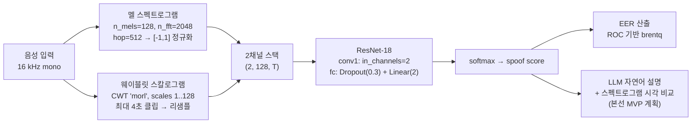
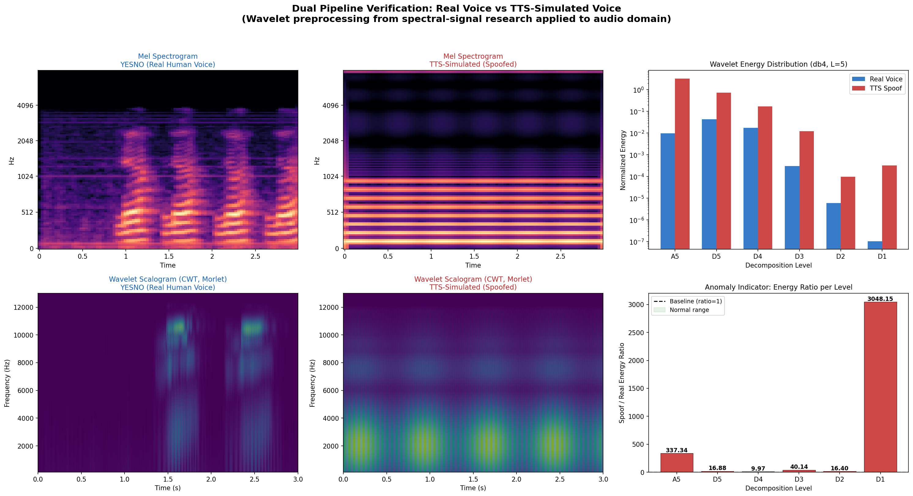
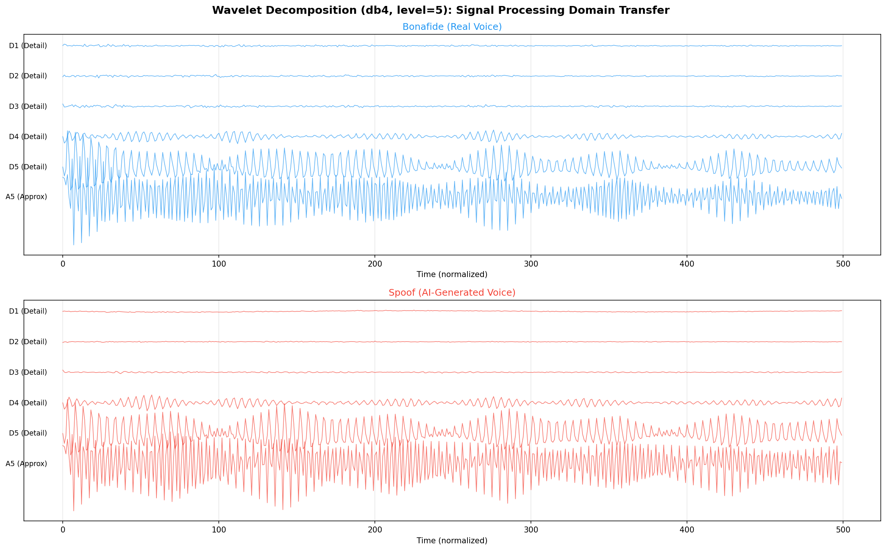

# 내 목소리 맞나요?: 음성 딥페이크 탐지 파이프라인

> 멜 스펙트로그램과 웨이블릿 스칼로그램을 **2채널로 융합**해 합성 음성을 판별하고, 판별 근거를 시민 눈높이로 설명하는 것을 목표로 한 음성 진위 확인 프로젝트.


- **대회**: AI Hack Camp 2026 — 디지털 안전 트랙 (생성형 AI 안정성 확보 및 딥페이크 탐지)
- **역할**: 음성 전처리 설계, 모델 학습 파이프라인 및 EER 평가 구현
- **상태**: 예선 제출 기준 사전 학습·검증 완료 단계의 코드베이스

### 이 저장소에서 부딪힌 것

EER이 5.50에서 3.80으로 내려갔지만, 비교한 두 실험의 입력 길이와 배치 크기가 달랐습니다. 그래서 좋아졌다고 단정하지 않고 조건을 같이 표로 남겼습니다.

---

## 문제 정의

대회가 제시한 트랙 과제는 **생성형 AI의 안정성 확보와 딥페이크 탐지**이며, 본 팀은 이를 *음성* 도메인에서 풀었다. 기획서에 정리한 문제 의식은 두 가지다.

1. **탐지 정확도의 한계** — 기존 딥페이크 탐지는 MFCC 등 **단일 특징**에 의존해, 정교하게 합성된 음성을 놓친다.
2. **설명의 부재** — "가짜입니다"라는 결과만 제공하면 시민은 *왜* 가짜인지 이해할 수 없고, 결과를 신뢰하거나 스스로 판단할 근거를 갖지 못한다.

따라서 이 프로젝트의 목표는 단순 분류기가 아니라, **다중 관점 신호 분석으로 탐지력을 높이고 그 판별 근거를 자연어와 시각 자료로 전달하는 파이프라인**이다.

설계상의 제약도 명시했다. 학습 데이터는 국제 공인 데이터셋(ASVspoof)만 사용하고, 사용자의 개인 음성은 수집·저장하지 않으며, 분석 중간 데이터는 즉시 폐기한다. 결과는 확률 기반 신뢰도 점수로만 제공하고 최종 판단은 사용자가 내린다.

---

## 접근 방법

핵심 아이디어는 **이중 파이프라인 특징 추출**이다. 주파수 영역(멜 스펙트로그램)과 시간–주파수 영역(웨이블릿 스칼로그램)을 병렬로 뽑아 **2채널 이미지**로 쌓고, ResNet-18의 첫 conv 레이어를 `in_channels=2`로 교체해 그대로 학습시킨다. 두 표현은 서로 다른 아티팩트를 포착하므로 상호 보완적이다.



단일 특징 베이스라인(`--feature mel`)은 동일 구조에 `in_channels=1`, 멜 1채널만 입력한다. 즉 **특징 표현을 바꾼 비교 (단, 입력 길이·배치가 함께 달라져 완전한 통제 비교는 아님 — 「실험 결과」의 교란 변수 표 참고)**가 되도록 모델·옵티마이저·에폭을 고정했다.

| 구성 요소 | 구현 | 파일 |
|---|---|---|
| 멜 스펙트로그램 | `librosa.feature.melspectrogram` → dB → 길이 패딩/절단 → `[-1,1]` 정규화 | `src/preprocessing/audio_features.py` |
| 웨이블릿 스칼로그램 | `pywt.cwt`, Morlet(`morl`), 128 스케일 | `src/preprocessing/audio_features.py` |
| 웨이블릿 에너지 벡터 | `pywt.wavedec`, Daubechies-4(`db4`), `level=5` | `src/preprocessing/audio_features.py` |
| 이중 파이프라인 결합 | `np.stack([mel, cwt])` → `(2, 128, T)` | `extract_dual_pipeline()` |
| 데이터셋 | ASVspoof 2019 LA CM 프로토콜 파서 + PyTorch `Dataset` | `src/preprocessing/dataset.py` |
| 모델 | `ResNetDetector`(ResNet-18, 가중치 미사전학습), `LightCNNDetector`(4블록 경량 CNN) | `src/models/resnet_detector.py` |
| 학습·평가 | CrossEntropy + Adam(`wd=1e-4`) + CosineAnnealingLR, dev EER 기준 best 체크포인트 저장 | `src/training/train.py` |
| EER | ROC 곡선에서 `FPR = FNR` 교점을 `scipy.optimize.brentq`로 해 (실패 시 최근접 fallback) | `compute_eer()` |

메모리 비용 때문에 시간축 길이는 특징별로 다르게 잡았다 — 멜 단일은 `max_len=300`, CWT가 포함된 이중은 `max_len=200`.

---

## 실험 결과

### 1. ASVspoof 2019 LA 학습 결과

아래 수치는 저장소 외부의 학습 체크포인트(`checkpoints/*.pt`)에 기록된 **dev EER 메타데이터에서 직접 확인한 값**이다. 두 실험 모두 ResNet-18 · 단일 시드이며, 서브셋 규모 5,000 utterance는 체크포인트에 기록돼 있지 않고 당시 기획 문서의 기술과 EER 값 일치로 추정한 것이다(`run_experiment.sh`는 `--max_samples`를 넘기지 않으므로 그 스크립트로 재실행하면 전체 파티션을 쓴다). 학습 스크립트가 dev EER 최저 시점에 저장한 모델이다. **단, 두 실험의 입력 조건은 같지 않다** — 아래 「이 비교의 교란 변수」를 먼저 읽을 것.

| 특징 표현 | 모델 | 입력 채널 | Best epoch | **Dev EER** |
|---|---|---|---|---|
| 멜 스펙트로그램 단일 | ResNet-18 | 1 | 4 | **5.50 %** |
| **멜 + 웨이블릿 이중** | ResNet-18 | 2 | 4 | **3.80 %** |
| 멜 스펙트로그램 단일 | 경량 CNN | 1 | 3 | 35.32 % |

서브셋·단일 시드 조건에서 이중 파이프라인의 dev EER이 더 낮게 관찰되었다(5.50 % → 3.80 %). **이 차이를 웨이블릿 채널의 효과로 단정할 수 없다.** 이유는 아래와 같다.
같은 입력으로 ResNet-18과 경량 CNN을 비교하면 백본 용량 차이가 지배적임은 분명하다(5.50 % vs 35.32 %).

**이 비교의 교란 변수** (코드에서 확인, 정정하지 않고 그대로 둠)

| 항목 | 멜 단일 | 멜 + 웨이블릿 | 근거 |
|---|---|---|---|
| 시간축 프레임 `max_len` | 300 | **200** | `src/training/train.py` — `max_len = 200 if dual else 300` |
| CWT 입력 길이 | — | **최대 4초로 절단** | `src/preprocessing/audio_features.py` `max_samples = sr * 4` |
| 배치 크기 (`run_experiment.sh`) | 32 | **16** | 메모리 때문 |
| 정규화 | 샘플별 min-max | 샘플별 min-max | 두 채널 모두 절대 에너지 정보가 사라짐 |
| CWT 시간축 축소 | — | 64,000 샘플 중 200 시점만 추출 | 프레임 집계가 아닌 희소 샘플링 |
| 모델 선택 | dev EER 최저 에폭 | dev EER 최저 에폭 | 보고한 dev EER은 선택에 쓴 값이라 낙관 편향 |
| 시드 / dev bonafide 수 | 1 / 약 500 | 1 / 약 500 | 1.7 %p 차이는 신뢰구간이 겹칠 수 있음 |

즉 이 비교는 "멜(300프레임) vs 멜(200프레임)+CWT(4초)"이다. 공정한 비교는 `max_len`·배치·시드를 통일하고 eval 파티션에서 재측정해야 하며, 이 저장소에는 그 결과가 없다.

> 근거: `checkpoints/best_mel_resnet.pt`, `best_dual_resnet.pt`, `best_mel_light.pt` 의 `eer` / `epoch` / `feature_type` / `model_type` 필드.
> 체크포인트 파일 자체는 용량 문제로 이 저장소에 포함하지 않았다.

### 2. 사전 실험: 파이프라인 동작 확인 (딥페이크 탐지 증거 아님)

ASVspoof 학습 전에 멜 + 웨이블릿 파이프라인이 끝까지 돌아가는지 확인한 실험이다. 진짜 음성은 YESNO 데이터셋 실제 녹음 3개를 썼지만, **"가짜 음성"은 TTS 출력이 아니라 손으로 합성한 신호다** — 기본주파수 배음 합 + 7.8 kHz 사인파 + 프레임 경계 클릭 (`src/download_asvspoof_sample.py` `generate_tts_like_audio`). 따라서 두 집단의 웨이블릿 에너지 차이는 **사람 목소리와 합성 톤의 차이**이지 진짜/딥페이크의 차이가 아니며, 탐지 성능의 근거로 쓸 수 없다. 레벨별 에너지 비 표는 그 이유로 README에서 뺐다(원본은 `docs/사전실험_보고서.md`).


> 근거: [`docs/사전실험_보고서.md`](docs/사전실험_보고서.md) (생성 스크립트: `src/run_real_experiment.py`)
> **한계**: 이 사전 실험은 실제 ASVspoof 스푸핑 음성이 아니라 TTS 특성을 *모사한* 합성 음성을 사용한 정성적 확인 수준이다. 정량 검증은 위 1절의 ASVspoof 학습 결과가 담당한다.

### 시각화

| 이중 파이프라인 비교 | 웨이블릿 분해 상세 |
|---|---|
|  |  |

파이프라인 구조도: [`docs/images/pipeline_architecture.png`](docs/images/pipeline_architecture.png) · 다중 샘플 일관성: [`docs/images/multi_sample_analysis.png`](docs/images/multi_sample_analysis.png)

---

## 저장소 구조

```
.
├── run_experiment.sh                  # 베이스라인 → 이중 파이프라인 전체 실험 실행
├── Makefile                           # setup / lint / smoke / reproduce / clean
├── Dockerfile                         # CPU 재현 환경 (libsndfile·ffmpeg 포함)
├── DATA.md                            # ASVspoof 2019 LA 내려받기·배치 안내
├── requirements.txt                   # 버전 고정 의존성
├── src/
│   ├── seed.py                        # random/numpy/torch 시드 일괄 고정
│   ├── preprocessing/
│   │   ├── audio_features.py          # 멜 / CWT 스칼로그램 / db4 에너지 / 이중 결합
│   │   └── dataset.py                 # ASVspoof 2019 LA 프로토콜 파서 + Dataset/DataLoader
│   ├── models/
│   │   └── resnet_detector.py         # ResNet-18 탐지기 + 경량 CNN
│   ├── training/
│   │   ├── train.py                   # 학습 루프 + dev EER 기반 체크포인트 저장
│   │   └── eval_only.py               # 저장된 체크포인트로 EER만 재측정
│   ├── run_real_experiment.py         # 사전 실험(웨이블릿 유효성 검증) + 보고서 생성
│   ├── experiment_wavelet_verification.py
│   ├── download_asvspoof_sample.py    # 샘플 오디오 준비
│   └── pipeline_architecture.py       # 파이프라인 구조도 생성
└── docs/
    ├── 사전실험_보고서.md              # 웨이블릿 검증 실험 결과
    ├── TIMELINE.md                    # 준비 일정 및 체크리스트
    └── images/                        # 실험 결과 그래프 및 구조도
```

> `datasets/`, `checkpoints/` 는 용량 문제로 저장소에 포함하지 않는다. 아래 실행 방법에 따라 재생성할 수 있다.

---

## 실행 방법

### 1. 환경 준비

```bash
pip install -r requirements.txt
```

`librosa` · `soundfile` · `torchvision` · `PyWavelets` 는 모두 `requirements.txt` 에 버전 고정으로 포함되어 있다.
`soundfile` 은 시스템 라이브러리 `libsndfile` 을 필요로 한다 (macOS: `brew install libsndfile`,
Debian/Ubuntu: `apt install libsndfile1`). 버전까지 고정된 환경이 필요하면 아래 [재현](#재현) 절의 Docker를 쓴다.

### 2. 데이터 배치

ASVspoof 2019 LA(ODC-By)를 내려받아 아래 위치에 둔다.

```
datasets/asvspoof2019_LA/LA.zip
```

### 3. 전체 실험 실행

```bash
bash run_experiment.sh
```

스크립트는 ① 압축 해제 및 데이터 구조 확인 → ② **멜 단일 + ResNet-18 베이스라인** 학습(10 epochs, batch 32, lr 1e-4) → ③ **멜+웨이블릿 이중 파이프라인** 학습(10 epochs, batch 16, lr 1e-4) → ④ 체크포인트 비교 순으로 진행한다.

### 4. 개별 실행

```bash
# 단일 특징 베이스라인
python3 src/training/train.py --data_dir datasets/asvspoof2019_LA/LA \
    --feature mel  --model resnet --epochs 10 --batch_size 32 --lr 1e-4

# 이중 파이프라인 (위 표의 3.80% 재현 조건: --max_samples 5000)
python3 src/training/train.py --data_dir datasets/asvspoof2019_LA/LA \
    --feature dual --model resnet --epochs 10 --batch_size 16 --lr 1e-4 --max_samples 5000

# 저장된 체크포인트로 EER만 재측정
python3 src/training/eval_only.py
```

`--feature {mel,dual}`, `--model {resnet,light}`, `--max_samples N`(서브셋 학습)을 지원한다. 디바이스는 MPS → CUDA → CPU 순으로 자동 선택된다.

### 5. 사전 실험 재현

```bash
python3 src/download_asvspoof_sample.py   # 샘플 오디오 준비
python3 src/run_real_experiment.py        # 웨이블릿 검증 + 그래프 → docs/images/
```

---

## 재현

위 "실행 방법"이 로컬 파이썬 환경 기준이라면, 이 절은 **환경째로 고정해 한 명령으로 돌리는** 경로다.

### 데이터 준비

ASVspoof 2019 LA는 용량·라이선스(ODC-By) 때문에 저장소에 포함하지 않았다.
내려받는 곳과 배치 경로는 [DATA.md](DATA.md)에 정리했다.

### Makefile

```bash
make help       # 타깃 목록
make setup      # requirements.txt 설치 (CPU torch 휠)
make lint       # src/ 문법 검사
make smoke      # 데이터셋 없이 파이프라인 동작 확인
make reproduce  # dev EER 비교 실험 재현 (데이터셋 필요)
make clean      # 캐시·중간 산출물 정리
```

| 타깃 | 하는 일 | 데이터 필요 | 소요 시간 |
|---|---|---|---|
| `make smoke` | 합성 난수 오디오 2초로 멜 → 웨이블릿 → 2채널 스택 → ResNet-18 forward 통과 확인 | ✗ | 수 초 |
| `make lint` | `compileall` + `ruff`(설치 시, 문법·미정의 이름 규칙만) | ✗ | 1초 미만 |
| `make pretest` | 웨이블릿 사전 실험 재현 (YESNO 샘플 자동 다운로드 + 합성 가짜 음성) | ✗ (네트워크 필요) | 수 분 |
| `make train-baseline` | 멜 단일 + ResNet-18, 5,000 utterance · 10 epoch | **✓** | GPU 수십 분 / CPU는 훨씬 김 |
| `make train-dual` | 멜+웨이블릿 이중 + ResNet-18 (`max_len` 200, 배치 16) | **✓** | CWT 연산 때문에 baseline보다 오래 걸림 |
| `make reproduce` | `train-baseline` → `train-dual` 순차 실행 후 체크포인트 비교 | **✓** | 위 둘의 합 |
| `make eval` | 저장된 체크포인트로 EER 재측정 | 체크포인트 필요 | 수 분 |

주요 변수는 덮어쓸 수 있다.

```bash
make reproduce DATA_DIR=/mnt/asvspoof/LA MAX_SAMPLES=1000 EPOCHS=3
```

> **소요 시간 주의** — 위 학습 시간은 추정치다. 본 재현 레이어를 정비하는 시점에
> ASVspoof 데이터가 로컬에 없어 `make reproduce` 를 끝까지 돌려 실측하지 못했다.
> 데이터 없이 검증한 것은 `make lint` 와 `make smoke` 다.

### Docker

CPU 전용 이미지로 파이썬·네이티브 라이브러리(libsndfile, ffmpeg) 버전까지 고정한다.

```bash
make docker-build          # = docker build -t voice-deepfake:cpu .
make docker-shell          # 데이터·체크포인트 볼륨을 붙여 셸 진입
```

이미지에는 **소스만** 들어간다. 데이터셋과 체크포인트는 볼륨으로 마운트한다.

```bash
docker run --rm -it \
  -v "$PWD/datasets:/app/datasets" \
  -v "$PWD/checkpoints:/app/checkpoints" \
  voice-deepfake:cpu \
  make reproduce
```

### 시드 고정

`src/seed.py` 의 `set_seed()` 가 `random` · `numpy` · `torch`(+cuDNN deterministic)를 한 번에 고정한다.
기본값 42는 `src/preprocessing/dataset.py` 가 서브셋 샘플링에 쓰는 기존 시드와 같은 값이며,
기존 동작을 덮어쓰지 않는다.

```python
from src.seed import set_seed
set_seed()            # 42
set_seed(1234, deterministic=False)   # GPU 속도 우선
```

---

## 기술 스택

| 분류 | 사용 기술 |
|---|---|
| 언어 | Python 3.10+ |
| 딥러닝 | PyTorch, torchvision (ResNet-18) |
| 오디오 | librosa, soundfile |
| 신호처리 | PyWavelets (CWT `morl`, DWT `db4`), scipy |
| 평가 | scikit-learn (`roc_curve`), scipy (`brentq`, `interp1d`) |
| 시각화 | matplotlib |
| 데이터셋 | ASVspoof 2019 LA (ODC-By) |
| 계획 단계 | Claude API(판별 근거 자연어 설명), Gradio(UI) |

---

## 한계 및 향후 과제

- **비교 조건 불일치** — 멜 단일과 이중 파이프라인은 `max_len`(300 vs 200)·배치(32 vs 16)·CWT 입력 길이(4초 절단)가 달라 동일 조건 비교가 아니다. 보고된 dev EER 차이를 웨이블릿 채널의 효과로 해석할 수 없다. 「실험 결과」의 교란 변수 표 참고.
- **사전 실험의 가짜 음성은 합성 톤** — TTS가 아니므로 탐지 성능 증거가 아니다.
- **학습 규모** — 저장소에서 검증 가능한 비교 실험은 5,000 utterance 서브셋, 10 epoch 조건이다. LA 전체(약 25,000 utterance) 학습 및 eval 파티션 기준 최종 EER은 재현 가능한 산출물이 없어 본 README에 기재하지 않았다.
- **일반화 미검증** — dev 파티션 EER만 확인했다. ASVspoof의 dev/eval 파티션은 공격 유형 구성이 달라 **eval EER은 통상 크게 상승**하며, 미지 공격(unseen attack)에 대한 일반화 검증이 필요하다.
- **한국어 교차 검증 부재** — 실제 활용 시나리오는 한국어 통화이나 ASVspoof 2019 LA는 영어 기반이다. 한국어 TTS 교차 검증이 남아 있다.
- **CWT 연산 비용** — `pywt.cwt`가 병목이라 이중 파이프라인은 입력을 4초·`max_len=200`으로 제한했다. 실시간 서비스를 위해서는 특징 사전 계산·캐싱 또는 경량 변환이 필요하다.
- **사전학습 가중치 미사용** — ResNet-18을 `weights=None`으로 스크래치 학습했다. 사전학습 백본이나 오디오 특화 백본(AASIST, RawNet2 등) 적용 시 개선 여지가 있다.
- **LLM 설명·UI 미구현** — 판별 근거의 자연어 설명(Claude API)과 Gradio UI는 기획 및 본선 MVP 계획 단계이며 본 저장소에는 코드가 없다.
- **경량 CNN 성능** — `LightCNNDetector`는 dev EER 35.32 %로 실사용 수준에 미달한다. 현 시점에서는 구조 비교용 레퍼런스다.

---

## 참고 문헌

1. Hu, J. et al. **"Raman spectral preprocessing scheme based on self-supervised learning" (RSPSSL)**, *Light: Science & Applications*, 2024. — 스펙트럼 신호의 **이중 인코더 구조**를 제안한 논문으로, 본 프로젝트의 이중 파이프라인 설계에 참조했다.
2. Todisco, M. et al. **"ASVspoof 2019: Future Horizons in Spoofed and Fake Audio Detection"**, *INTERSPEECH*, 2019. — 본 프로젝트의 학습·평가 데이터셋 및 CM 프로토콜.
3. He, K. et al. **"Deep Residual Learning for Image Recognition"**, *CVPR*, 2016. — 탐지 백본으로 사용한 ResNet-18.

---

## 라이선스

[MIT License](LICENSE) — 본 저장소의 코드 및 문서에 한한다.
ASVspoof 2019 데이터셋은 ODC-By 라이선스를 따르며 본 저장소에 포함되지 않는다.
